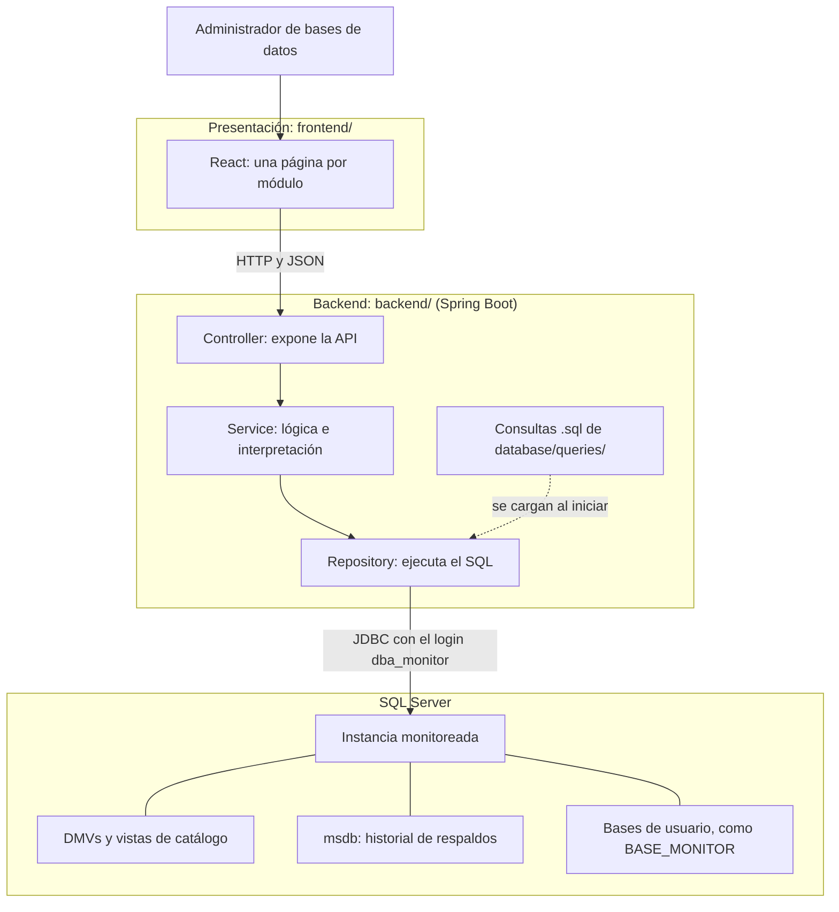
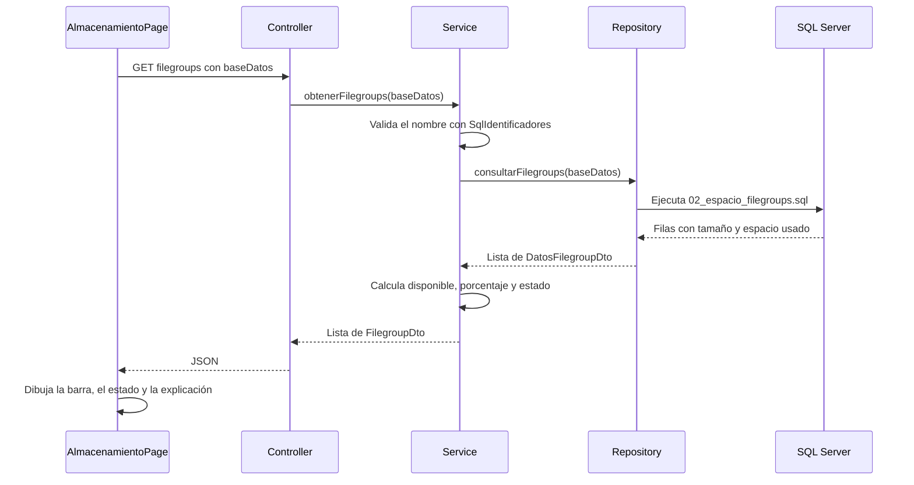

# Arquitectura y decisiones de diseño

DBA Monitor centraliza información de una instancia de SQL Server para el caso de estudio de
DataSolutions Costa Rica S.A., cuyo equipo de TI debe consultar manualmente distintas vistas del
sistema para diagnosticar problemas. Este documento explica cómo está construida la solución y por qué.

- Instalación: [README](../README.md) e [instalación detallada](instalacion.md)
- Uso: [manual de usuario](manual-usuario.md)
- Consultas e indicadores de cada módulo: `docs/modulo1-instancia.md` a `docs/modulo6-mantenimiento.md`

## 1. Vista general

La solución es una aplicación web con tres partes separadas: presentación, lógica del negocio y acceso
a los datos. El navegador nunca se conecta a SQL Server: solo conversa con la API.



### Servidor, instancia y base de datos

| Concepto | Qué es | Dónde se ve en la solución |
|---|---|---|
| Servidor | El equipo donde está instalado SQL Server. | Módulo 1: *Servidor*. |
| Instancia | Una instalación independiente del motor, con su servicio, memoria y logins. Un servidor puede tener varias. | La aplicación se conecta a una, definida en la URL de conexión. |
| Base de datos | Objetos y datos que viven dentro de una instancia. | Los módulos 3, 5 y 6 trabajan sobre la base elegida en pantalla. |

### Tecnologías

| Parte | Tecnología |
|---|---|
| Gestor de base de datos | Microsoft SQL Server (desarrollo en SQL Server 2022 Express) |
| Backend | Java 17, Spring Boot 4.1 (Web MVC, JDBC y validación), controlador `mssql-jdbc` |
| Frontend | React 19, React Router 7, Vite 6. Los gráficos son componentes SVG propios. |
| Pruebas | JUnit y Mockito |
| Control de versiones | Git y GitHub |

## 2. Capas del backend

Cada módulo es un paquete con las mismas clases, y cada una tiene una sola responsabilidad.

| Capa | Responsabilidad | Ejemplo en el Módulo 3 |
|---|---|---|
| `Controller` | Define las rutas y recibe los parámetros. No tiene lógica. | `AlmacenamientoController` expone `GET /api/almacenamiento/filegroups`. |
| `Service` | Valida la entrada, calcula e interpreta los resultados. | `AlmacenamientoService` calcula el porcentaje de uso y decide si el estado es `NORMAL`, `ATENCION` o `CRITICO`. |
| `Repository` | Ejecuta el SQL y convierte cada fila en un objeto. No tiene lógica. | `AlmacenamientoRepository` ejecuta `02_espacio_filegroups.sql`. |
| `dto` | Define los datos que viajan entre capas y hacia el frontend. | `DatosFilegroupDto` (fila de la consulta) y `FilegroupDto` (respuesta con la interpretación). |

El paquete `common` tiene lo compartido: la carga de consultas (`CargadorConsultasSql`), la validación
de identificadores (`SqlIdentificadores`) y el manejo de errores (`GlobalExceptionHandler`). `config`
contiene la configuración de CORS y `salud` expone la verificación de conexión de la barra superior.

### Recorrido de una solicitud

Así se atiende `GET /api/almacenamiento/filegroups?baseDatos=BASE_MONITOR`:



## 3. Frontend

| Carpeta | Contenido |
|---|---|
| `src/api/` | `cliente.js` centraliza las llamadas HTTP y los errores; `endpoints.js` define las rutas por módulo. |
| `src/hooks/` | `useConsulta` administra los estados de una consulta: cargando, datos, error y recargar. |
| `src/components/` | Componentes compartidos: navegación, tablas, medidores y mensajes de estado. |
| `src/modulos/<modulo>/` | La página de cada módulo. |
| `src/utils/formato.js` | Formato común de fechas, tamaños, duraciones y números. |

Usar los mismos componentes en todas las páginas mantiene consistentes las tablas, las unidades y los
mensajes. Además, una consulta que falla solo afecta a su bloque y no a toda la pantalla.

## 4. Organización del repositorio

```
backend/src/main/java/cr/ac/una/dbamonitor/
    instancia/  rendimiento/  almacenamiento/  respaldo/  auditoria/  mantenimiento/
    salud/  common/  config/
backend/src/test/                  Pruebas unitarias
frontend/src/                      Interfaz en React
database/queries/modulo#_nombre/   Consultas de cada módulo, numeradas y documentadas
database/scripts/                  Base de práctica, login, permisos y generación de datos
docs/                              Documentación
```

| Módulo | Paquete | Pantalla | Fuentes principales |
|---|---|---|---|
| 1. Instancia | `instancia` | `/instancia` | `SERVERPROPERTY`, `sys.dm_os_sys_info`, `sys.dm_os_process_memory`, `sys.databases` |
| 2. Rendimiento | `rendimiento` | `/rendimiento` | `sys.dm_exec_query_stats`, `sys.dm_exec_sessions`, `sys.dm_exec_requests` |
| 3. Almacenamiento | `almacenamiento` | `/almacenamiento` | `sys.master_files`, `sys.filegroups`, `sys.allocation_units`, `msdb.dbo.backupset` |
| 4. Respaldos | `respaldo` | `/respaldos` | `msdb.dbo.backupset`, `msdb.dbo.backupmediafamily`, `sys.dm_exec_requests` |
| 5. Auditoría | `auditoria` | `/auditoria` | `sys.server_principals`, `sys.database_principals`, `sys.database_permissions`, `sys.sql_expression_dependencies` |
| 6. Mantenimiento | `mantenimiento` | `/mantenimiento` | `sys.dm_db_stats_properties`, `sys.sql_expression_dependencies`, `UPDATE STATISTICS`, `sp_refreshsqlmodule`, `sp_recompile` |

## 5. Decisiones de diseño

### Consultas SQL en archivos, no dentro del código

**Decisión:** cada consulta vive en `database/queries/`, con un encabezado que explica su fuente, unidades
y permiso. Maven las copia al classpath y `CargadorConsultasSql` las lee al iniciar.

**Por qué:** el SQL es el centro del proyecto y debe poder revisarse y ejecutarse por separado. Lo
documentado es exactamente lo que ejecuta la aplicación, sin copias que se desactualicen.

**Consecuencia:** después de cambiar un `.sql` hay que reiniciar el backend.

### JdbcTemplate en lugar de un ORM

**Decisión:** el acceso a datos usa `JdbcTemplate` de Spring.

**Por qué:** la aplicación lee vistas del sistema y DMVs con consultas específicas de SQL Server, no
entidades propias. Un ORM agregaría mapeos sin aportar valor, y este enfoque permite controlar el SQL.

### Una sola conexión a `master` y nombres de tres partes

**Decisión:** la conexión apunta siempre a `master`. Para consultar una base, las consultas usan nombres
como `[BASE_MONITOR].sys.objects`, y la base se elige en cada solicitud.

**Por qué:** los datos de servidor son visibles desde cualquier base, y así se cambia de base desde la
pantalla sin reconfigurar ni reiniciar el backend.

**Consecuencia:** funciones como `SCHEMA_NAME()` responderían según `master`, por lo que el esquema se
obtiene de `[base].sys.schemas`. Los procedimientos del sistema se invocan como `[base].sys.sp_recompile`.

### Validar los identificadores contra una lista de caracteres permitidos

**Decisión:** T-SQL no permite enviar un nombre de objeto como parámetro `?`, así que el nombre se valida
con `SqlIdentificadores` (solo letras, números, `_`, `#` y `$`) y se escribe entre corchetes. Los valores
de una cláusula `WHERE` sí se envían como parámetros.

**Por qué:** impide la inyección SQL en esa posición, sin depender de escapar comillas.

**Consecuencia:** hoy no se pueden analizar bases con guiones o espacios en el nombre (ver sección 8).

### Interpretar los datos en el backend

**Decisión:** el `Service` agrega estados y explicaciones, como el nivel de riesgo de los respaldos o el
estado de un filegroup. Los umbrales son constantes con nombre.

**Por qué:** el enunciado pide evitar resultados sin contexto. La regla queda en un solo lugar, se puede
probar sin base de datos y el frontend solo la muestra.

### Mínimo privilegio para el login de la aplicación

**Decisión:** la aplicación usa el login `dba_monitor`, que no es sysadmin y recibe solo los permisos
indicados en la sección 6.

**Por qué:** una herramienta de monitoreo no necesita control total. Si sus credenciales se filtraran, el
daño posible sería mucho menor. Se usa `db_ddladmin` y no `db_owner` para que pueda hacer mantenimiento
sin recibir permiso para leer los datos.

### Crecimiento obtenido del historial de respaldos

**Decisión:** el crecimiento se calcula con el tamaño que `msdb` registra en cada respaldo completo.

**Por qué:** SQL Server no guarda un historial de tamaños, y guardarlo periódicamente requeriría un
proceso programado, pero Express no incluye SQL Server Agent. Esta fuente es real y no agrega objetos.

**Consecuencia:** una base sin respaldos no tiene historial, y la pantalla lo explica.

### Dos revisiones para los objetos inválidos

**Decisión:** SQL Server no tiene un estado `INVALID` como Oracle, así que se usan dos revisiones:

| Revisión | Detecta | Cuándo se ejecuta |
|---|---|---|
| Catálogo `sys.sql_expression_dependencies` | Tablas u objetos que faltan en la base | Al abrir los módulos 5 y 6 |
| `sp_refreshsqlmodule` en una transacción que se revierte | Columnas eliminadas y otros errores al analizar el objeto | Solo con el botón **Validar objetos** |

**Por qué:** cada una ve lo que la otra no. A un procedimiento le puede faltar una tabla sin que
`sp_refreshsqlmodule` falle, y el catálogo no detecta una columna eliminada. La segunda requiere `ALTER`
y analiza cada objeto, por eso no se ejecuta al abrir la pantalla.

**Recompilar:** `sp_recompile` no valida el objeto, así que la acción ejecuta también
`sp_refreshsqlmodule` y luego vuelve a revisar el catálogo. Así solo confirma éxito si el objeto quedó
sin referencias rotas.

### Consultar bajo demanda

**Decisión:** las pantallas consultan al abrirse y con el botón ⟳. Solo el Módulo 2 ofrece actualización
automática, cada 15 s, y únicamente si el usuario la activa. Las consultas de mayor volumen usan `TOP`.

**Por qué:** una herramienta de monitoreo no debe convertirse en una carga para el servidor que vigila.

### Manejo centralizado de errores

**Decisión:** `GlobalExceptionHandler` convierte las excepciones en respuestas JSON con mensajes en
español. El detalle técnico queda en el log del backend.

| Situación | Respuesta |
|---|---|
| Nombre de base, esquema u objeto no válido | HTTP 400 |
| Ruta inexistente o método no permitido | HTTP 404 o 405 |
| Sin conexión con SQL Server | HTTP 503 |
| Error en una consulta o falta de permisos | HTTP 500 con un mensaje claro |
| Recalcular o recompilar falla | HTTP 200 con `exito = false` y la explicación |
| Consulta sin resultados | Lista vacía; la pantalla explica qué significa |

**Por qué:** el usuario siempre recibe un mensaje comprensible, sin exponer datos de conexión.

## 6. Seguridad y permisos

| Permiso | Dónde | Para qué | Script |
|---|---|---|---|
| `VIEW SERVER STATE` | Servidor | Leer las DMVs de actividad | `01_crear_login_monitor.sql` |
| `VIEW ANY DEFINITION` | Servidor | Leer metadatos sin acceder a los datos | `01_crear_login_monitor.sql` |
| Usuario `dba_monitor` | Cada base analizada | Entrar a la base para leer su catálogo | `02` y `03` |
| `SELECT` en `sys.sql_expression_dependencies` | Cada base analizada | Detectar objetos inválidos | `02_permisos_mantenimiento.sql` |
| Rol `db_ddladmin` | Cada base analizada | Recalcular, recompilar y validar | `02_permisos_mantenimiento.sql` |
| `SELECT` en `backupset`, `backupfile` y `backupmediafamily` | `msdb` | Leer el historial de respaldos | `03` y `04` |

**Credenciales:** la contraseña real va en `application-local.properties`, que Git ignora. En el repositorio
solo está `application-example.properties`, con valores de ejemplo, y los scripts usan `<CAMBIAR_CONTRASENA>`.

**Conexión:** usa `encrypt=true`. En desarrollo también `trustServerCertificate=true`, porque la instancia
local usa un certificado que no proviene de una autoridad de confianza. En producción habría que instalar
un certificado válido y quitar esa opción.

**Acceso a la API:** CORS solo admite el frontend de desarrollo (`http://localhost:5173`). La API no tiene
autenticación de usuarios porque el proyecto se ejecuta localmente y no está pensado para producción.

## 7. Cómo agregar un módulo

La aplicación se puede ampliar sin cambiar los módulos existentes:

1. Agregar las consultas numeradas en `database/queries/modulo7_nombre/`, con su encabezado.
2. Si requiere permisos, agregar un script numerado en `database/scripts/`.
3. Crear el paquete del backend con su `Controller`, `Service`, `Repository` y `dto/`.
4. Agregar las rutas a `frontend/src/api/endpoints.js`.
5. Crear la página en `frontend/src/modulos/` y usar los componentes compartidos.
6. Registrar la ruta en `App.jsx` y el enlace en `MODULOS` de `Layout.jsx`.
7. Agregar sus pruebas y documentarlo en `docs/`.

## 8. Limitaciones conocidas

| Limitación | Efecto | Cómo se atiende |
|---|---|---|
| Express no incluye SQL Server Agent | No se pueden programar respaldos ni mantenimiento. | Las acciones se ejecutan desde la aplicación o con scripts; el Módulo 1 muestra las limitaciones de la edición. |
| Express limita memoria, CPU y tamaño | 1410 MB de buffer pool, 10 GB por base y hasta 1 socket o 4 núcleos. | Se muestran en el Módulo 1. |
| `msdb` no registra los respaldos fallidos | El Módulo 4 no puede mostrarlos. | Se identifican los respaldos terminados con problemas y se alerta si el último es antiguo. |
| Las estadísticas de consultas dependen de la caché de planes | Se pierden al reiniciar o bajo presión de memoria, y `AUTO_CLOSE` también puede vaciarlas. | La pantalla lo explica y el script 06 genera actividad. |
| Con poca memoria libre, las consultas pueden demorarse | Se han medido esperas de hasta 25 s en un equipo con poca RAM disponible. | Liberar memoria en el equipo antes de usar la aplicación. |
| Una instancia a la vez | Cambiar de instancia requiere cambiar la URL y reiniciar el backend. | El enunciado excluye administrar varios servidores a la vez. |
| Nombres de objeto restringidos | No se pueden analizar bases con guiones o espacios. | Se rechazan con un mensaje claro. |
| Permisos por base | Solo se analizan las bases donde se ejecutaron los scripts. | Los selectores muestran únicamente las bases accesibles. |

## 9. Pruebas

Las pruebas unitarias se ejecutan con `.\mvnw.cmd test` desde `backend/`. Cubren la lógica de los service
de los módulos 2 a 6, sin necesitar una base de datos:

| Clase | Pruebas | Qué verifica |
|---|---|---|
| `RendimientoServiceTest` | 6 | Clasificación de bloqueos, sesión raíz y orden de procesos |
| `AlmacenamientoServiceTest` | 7 | Estados de filegroups, textos de crecimiento e historial |
| `RespaldoServiceTest` | 7 | Niveles de riesgo y estado de cada respaldo |
| `AuditoriaServiceTest` | 3 | Agrupación de roles, incluidos los que no tienen miembros |
| `MantenimientoServiceTest` | 4 | Resultado de recompilar y validación de la base |

`DbamonitorApplicationTests` comprueba además que la aplicación inicia, y para eso necesita
`application-local.properties`. Las consultas SQL no tienen pruebas automáticas; se verifican contra una
instancia real.

## 10. Posibles mejoras

- Permitir que el usuario cambie de instancia desde la pantalla, sin reiniciar el backend.
- Leer el log de errores de SQL Server para mostrar los respaldos fallidos.
- Admitir cualquier nombre de base, escapando los identificadores como lo hace `QUOTENAME`.
- Guardar periódicamente el tamaño de las bases para tener un historial independiente de los respaldos.
- Exportar reportes y agregar un panel con el estado de salud de todos los módulos.
- Agregar autenticación a la API y certificados válidos para usarla fuera de un entorno local.
- Agregar pruebas de integración de las consultas SQL.
